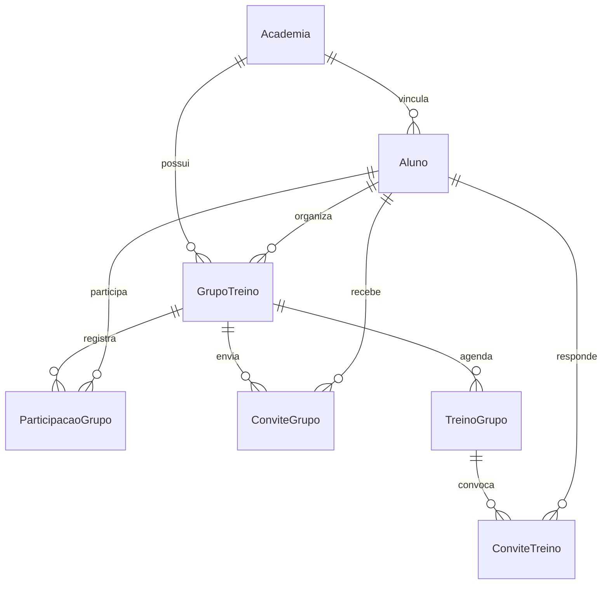

# Entrega — Grupos de treino

Atualização dos convites em 06/11/2026: a busca agora usa o nome de usuário exato do login, sem diferenciar maiúsculas, e não lista alunos ao abrir a tela. O resultado mostra usuário e nome para identificação. Foram executados 50 testes de integração dos grupos em H2 isolado, todos aprovados, e o build Angular. Nenhuma conta foi adicionada ao banco de desenvolvimento nesta correção. Os totais abaixo documentam a validação completa anterior.

Validação em 06/11/2026, no projeto real `treinoconectacore`, preservando os módulos D5. Requisitos e desenhos das páginas 21–28 de [atividade.pdf](../atividade.pdf), com decisões documentadas em [F004](../core/funcionalidades/F004-grupos-treino.md).

## Implementação

Menu **Grupos de treino** ativo; telas de meus grupos, criação com seleção de alunos, detalhes/administração, proposta de treino, convites, detalhes de presença e histórico. Persistência real, sessão/CSRF existente, validação no servidor, permissões, mensagens de sucesso/erro, estados vazios, paginação e apresentação responsiva. Confirmação antes de sair, encerrar ou cancelar.

Entidades e relacionamentos:



`GrupoTreino` é a raiz transacional; participação, convite de entrada, encontro e convite de presença pertencem ao agregado. Objetos de valor identificam referências externas. Entidades possuem transições de estado; o serviço resolve identidade, obtém bloqueio e persiste. JPA usa relações LAZY e mapeamento explícito. CQRS fornece projeções paginadas e contagens no banco.

`TreinoGrupo` é separado do `Treino` individual com professor, já usado pelas avaliações. Nenhum encontro gera artificialmente avaliações, professores disponíveis ou frequência.

## RN01–RN08

Pacote de domínio: [grupotreino](../../dominio-core/src/main/java/br/edu/cesar/treinoconecta/treinoconectacore/dominio/core/grupotreino).

| Regra | Implementação | Evidência |
|---|---|---|
| RN01 | `NomeGrupo` normaliza extremos e valida 1–60; frontend `validarNome` | vazio, espaços, limite exato e excedido |
| RN02 | `GrupoTreino.criar`, `exigirOrganizador`, `GrupoTreinoServico.autenticado` | organizador automático, autoria não forjada, acesso negado aos demais |
| RN03 | `convidar`, `responderConvite`; FK de academia, unicidades e bloqueio da raiz | academia diferente, duplicação, destinatário, reentrada e corrida entre duas aceitações |
| RN04 | `TreinoGrupo.propor`; criação e convites na mesma transação D5 | datas/prazos inválidos, snapshot dos membros, unicidade e rollback quando um convite falha |
| RN05 | `exigirMembro`, `ConviteTreino.responder` | destinatário, pendência, prazo, treino cancelado e respostas contraditórias concorrentes |
| RN06 | `situacaoEm`, `expirar`, `ExpiracaoConvites`; projeções com Clock | leitura antes do scheduler, vencimento automático sem HTTP, repetição idempotente e confirmado preservado |
| RN07 | `cancelarPresenca` | fronteira exata de uma hora, nanossegundo posterior, autoria, remoção dos confirmados e datas preservadas |
| RN08 | `sair`, `encerrar`, `TreinoGrupo.cancelar` | saída bloqueada por presença futura, organizador não abandona, fechamento preserva passado e cancela futuro |

Os [endpoints e exemplos](../core/api-grupos.md) detalham todas as operações.

## Testes executados

| Validação | Resultado |
|---|---|
| `mvn package` | 180 testes Java aprovados, zero falhas/erros; JAR gerado |
| Domínio | 39 cenários Cucumber, dos quais 8 novos de grupos, e 1 teste unitário existente |
| Backend | 140 testes; 49 novos cenários de integração de grupos, 1 scheduler e 1 migração; 89 testes anteriores preservados |
| `npm test -- --watch=false` | 15 testes Angular aprovados, incluindo 6 de grupos |
| Playwright | 11 fluxos aprovados: 8 existentes e 3 novos de grupos; desktop, celular e prazo terminando com a tela aberta |
| `npm run build` | Bundle Angular gerado |
| Context Mapper | `docs/core/projeto.cml` validado sem erros |

Os testes Java usam H2 em memória isolado e migrações reais, Clock controlável, chamadas HTTP com sessão/CSRF e conexões distintas nas corridas. Um teste de agendamento usa o scheduler real sem requisições HTTP. A falha de geração de convite é provocada por restrição temporária do banco para comprovar rollback integral.

Os testes de navegador criam suas próprias contas; seus grupos são encerrados ao final. Registros de teste permanecem como histórico no banco de desenvolvimento. Foram observadas e corrigidas expectativas de status HTTP nos testes (o D5 usa 422 nas validações de domínio e 409 nas restrições do banco) e a preparação do token CSRF após login no teste de prazo. Nenhum teste foi desabilitado.

Evidências: [grupo no computador](22-grupo-treino.png) e [treino no celular](23-grupo-treino-celular.png).

## Execução

Com JDK 25 configurado, na raiz do projeto:

```powershell
mvn package
java -jar ui-backend/target/treinoconectacore-ui-backend-1.0.0-SNAPSHOT.jar --spring.profiles.active=desenvolvimento
```

Neste workspace, o cache Maven está em `../.m2/repository`: acrescente `'-Dmaven.repo.local=../.m2/repository'` ao Maven. O JDK portátil fica em `../.tools/java25/jdk-25.0.5+8`.

Em outro terminal:

```powershell
cd ui-frontend/src/main/angular
npm ci
npm start -- --host 127.0.0.1
```

Abra http://127.0.0.1:4200. Contas locais de desenvolvimento: **u/u** e **v/v**. Também é possível criar duas contas em `/cadastro` e usar navegadores/sessões diferentes para testar convites. Entre em **Grupos de treino → Criar grupo**, selecione o outro aluno, aceite o convite nessa outra sessão e proponha um treino.

Para repetir verificações: `mvn test`, `npm test -- --watch=false`, `npm run build` e, com servidores abertos e Edge instalado, `npm run test:e2e`.

## Expiração e preservação

`ExpiracaoConvites` roda a cada 1.000 ms por padrão. Busca até 100 grupos com pendências vencidas, bloqueia cada raiz e usa uma transação por grupo. Apenas pendências vencidas mudam para EXPIRADO. Reexecuções são idempotentes. Na retomada da aplicação, vencimentos acumulados são processados; leituras e comandos já respeitam o prazo independentemente do ciclo.

Configurações: `treino.grupos.agendamento=true` e `treino.grupos.intervalo-ms=1000`. `false` existe para isolamento dos testes, não deve ser usado para operação normal. O Clock UTC existente é reutilizado; a interface exibe Brasília.

Migração V5 mantém reservas, avaliações e treinos antigos e vincula alunos à academia atual. Backup local anterior à migração: `../.tools/treino-conecta-antes-grupos-20261106.mv.db`. Nenhum dado histórico de grupo é excluído fisicamente. Cancelamentos guardam resposta anterior, data e motivo.

## Limites do escopo

- Sem pendência funcional nas RN01–RN08. Os convites são entregues dentro do sistema; envio por e-mail/push não faz parte desta implementação.
- A instalação original não possuía academia no domínio: alunos existentes e novos cadastros públicos usam a academia Treino Conecta. Outras academias e alterações de vínculo exigem provisionamento administrativo; não há tela administrativa de matrículas.
- Agendamento com disponibilidade de professor/sala e registro de frequência, ilustrados no PDF, dependem de módulos inexistentes. O encontro do grupo não é convertido automaticamente em treino avaliável.
- H2 foi o banco validado. Colunas geradas de unicidade exigirão adaptação numa troca de SGBD. Os comandos carregam o agregado completo sob bloqueio; grupos com históricos muito grandes podem exigir particionar esse agregado mantendo a mesma política de concorrência.
- O build Angular mantém avisos de tamanho do bundle e de estilos; a compilação conclui. O validador CML emite avisos de compatibilidade do Java/EMF depois de confirmar a validação.
